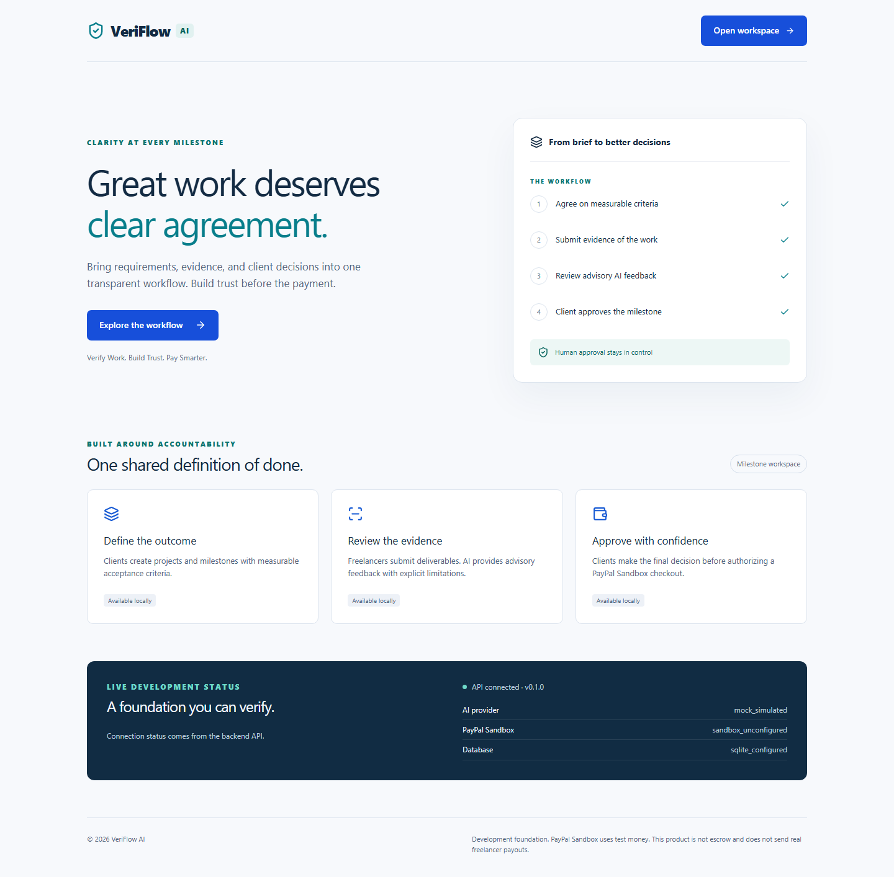
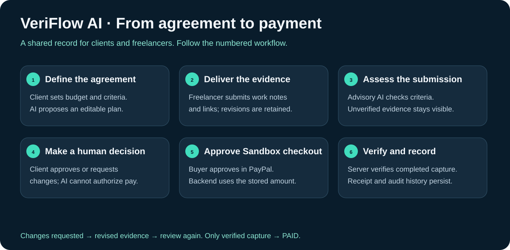
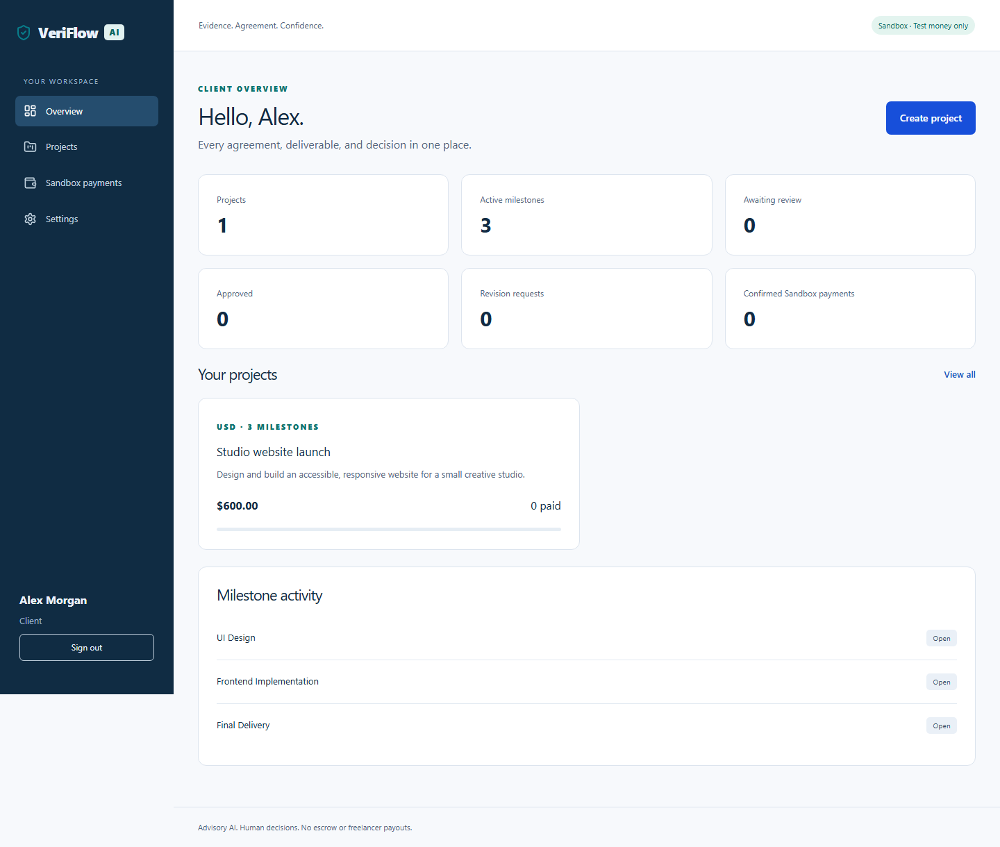
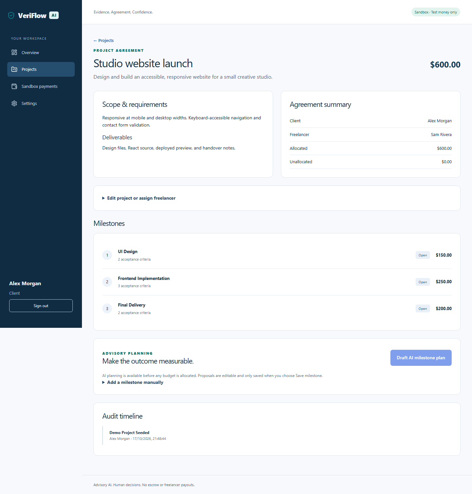
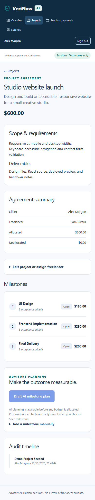
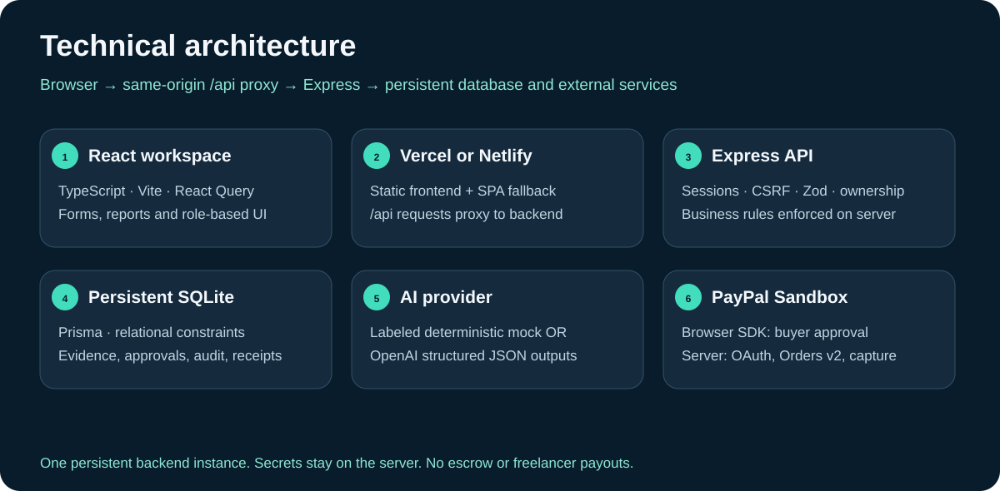

# VeriFlow AI

**VeriFlow AI is a working milestone workspace for clients and freelancers: agree on deliverables, submit versioned evidence, review advisory AI feedback, make a human approval decision, and pay through server-verified PayPal Sandbox checkout.** It brings the agreement, delivery history, decision and payment receipt into one traceable project record.

Built for the **PayPal AI Hackathon 2026** with React, TypeScript, Express, Prisma, SQLite, OpenAI structured outputs and PayPal Orders v2.



[Get started](#run-locally) · [Deployment](docs/DEPLOYMENT.md) · [Judge walkthrough](docs/DEMO.md) · [Devpost answers](docs/DEVPOST.md) · [Test evidence](docs/TEST_RESULTS.md) · [MIT license](LICENSE)

## What we built

Freelance payment disputes often begin with an unclear definition of done. VeriFlow connects measurable acceptance criteria to delivery evidence and a recorded client decision before checkout.

- **Two-role workspace:** clients manage projects and budgets; assigned freelancers deliver work.
- **Milestone agreements:** explicit criteria, currency and integer minor-unit amounts; allocations cannot exceed the budget.
- **AI planning:** generate suggestions, inspect risks, edit them and explicitly save the agreement.
- **Evidence and revisions:** submit descriptions, reproduction notes and reference links while retaining earlier submissions.
- **Advisory assessment:** criterion-level feedback, missing evidence and clear limitations. A client independently approves or requests changes.
- **PayPal Sandbox checkout:** server-created orders, buyer approval, idempotent capture and exact amount/currency verification.
- **Persistent history:** shared audit events, decisions, payment attempts and receipts, protected by participant authorization.
- **Responsive interface:** desktop and mobile project views, accessible labels and clear loading/error states.

**Verification boundary:** the local workflow and automated provider contracts are tested. Without credentials, AI runs in visibly labeled deterministic mock mode and checkout is disabled. A real OpenAI adapter and real PayPal Sandbox adapter are implemented; actual credential-backed AI requests and buyer-approved captures remain to be verified. This is a hackathon application, not a live payment service, escrow or freelancer payout system.

## The implemented flow



1. A client creates a project, sets a budget and assigns a registered freelancer.
2. The client reviews an AI milestone proposal or writes milestones manually.
3. The freelancer submits evidence. Changes requests allow numbered revisions.
4. AI organizes the submission against the criteria. Reference URLs are stored, **not fetched or independently inspected**.
5. The client starts review, inspects the work and records approval or requests changes.
6. Approval enables PayPal Sandbox checkout. The server marks `PAID` only after verifying a completed capture; uncertain outcomes require reconciliation.

AI never approves work or authorizes payment. The browser callback alone never proves payment.

## Actual application screenshots

Screenshots below come from the running local application with seeded demo data. They are not design mockups or proof of external provider transactions.

### Client dashboard



### Project agreement and milestones



<details>
<summary>Mobile project view</summary>



</details>

Recreate the screenshots with `node scripts/capture-docs.mjs` after seeding and starting the app. Regenerate the diagrams with `node scripts/create-diagrams.mjs`.

## Run locally

Requires **Node.js 24 LTS**, npm and Git. SQLite is local; no Docker or provider account is required for mock-mode development. Native SQLite/bcrypt dependencies may need C++ build tools if a prebuilt binary is unavailable.

```powershell
git clone https://github.com/padalasuraj/veriflow.git
cd veriflow
npm.cmd ci
# Preserve any existing credentials:
if (-not (Test-Path backend/.env)) { Copy-Item backend/.env.example backend/.env }
npm.cmd run db:generate
npm.cmd run db:migrate
npm.cmd run db:seed
npm.cmd run db:verify
npm.cmd run dev
```

Open **http://localhost:5173**. API health: **http://localhost:3001/api/health**. Keep the terminal running; Ctrl+C stops both services. On macOS/Linux use `npm` and `cp -n backend/.env.example backend/.env` instead of the PowerShell copy command. On Windows, `npm.cmd` avoids PowerShell script execution-policy errors.

### Local demo accounts

| Role | Email | Password |
| --- | --- | --- |
| Client | `client@veriflow.local` | `VeriflowDemo2026!` |
| Freelancer | `freelancer@veriflow.local` | `VeriflowDemo2026!` |

Seed creates **Studio website launch**, budget **$600 USD**, with $150 design, $250 implementation and $200 delivery milestones. It preserves existing progress. These accounts are local-only; seeding is blocked in production. Use separate browser profiles for a two-role demonstration. On a public deployment, register fresh accounts and share judge access privately.

## Architecture and technical skills



| Layer | Technologies and implementation |
| --- | --- |
| Web | React 19, TypeScript, Vite, Tailwind CSS, Lucide, React Router |
| Forms and data | React Hook Form, Zod, TanStack Query |
| API | Node.js, Express 5, typed routes, transactional lifecycle rules |
| Persistence | Prisma 7, SQLite, migrations, unique constraints and audit records |
| Identity | bcrypt, hashed opaque session tokens, HttpOnly cookies, CSRF, role/ownership checks |
| AI | OpenAI Chat Completions strict JSON schemas, Zod validation, bounded requests; separate labeled mock provider |
| Payments | PayPal JavaScript SDK, server-side OAuth and Orders v2, persistent idempotency keys, verified capture |
| Verification | Vitest, Supertest, Testing Library, Playwright, GitHub Actions |
| Hosting | Vercel/Netlify SPA proxy configuration; Render backend with a persistent disk |

Technical work includes state modeling, API design, authentication, authorization, database transactions, payment reconciliation, prompt/output validation, responsive UI and browser automation.

```text
frontend/src/        Pages, forms, authentication context and API client
backend/src/         Express routes, access rules, AI and PayPal adapters
backend/prisma/      Relational schema, migration and non-destructive demo seed
backend/scripts/     Migration, database verification and compiled API smoke check
e2e/                 Browser health, two-role workflow and controlled checkout tests
scripts/             Hosting configuration, diagrams and screenshot capture
docs/                API, security, deployment, demo and submission guides
.github/workflows/   Automated quality checks
```

## Configure AI and PayPal

Private values belong in **backend/.env** locally or backend hosting environment variables. Never put secrets in `VITE_*`, Git, screenshots or submission text.

| Variable | Purpose / default |
| --- | --- |
| `PORT` | API port; default `3001` |
| `FRONTEND_ORIGIN` | Exact browser origin, default `http://localhost:5173`; no trailing slash |
| `NODE_ENV` | `development`, `test` or `production` |
| `DATABASE_URL` | `file:./prisma/dev.db` locally; persistent absolute path when hosted |
| `AI_MODE` | `mock` for labeled simulation; `real` for OpenAI |
| `AI_MODEL` | Default `gpt-4.1-mini`; must support strict JSON-schema outputs |
| `AI_API_KEY` | Private OpenAI API key, required in real mode |
| `PAYPAL_ENV` | `sandbox` only; live mode is rejected |
| `PAYPAL_CLIENT_ID` | Sandbox REST app client ID |
| `PAYPAL_CLIENT_SECRET` | Private Sandbox REST app secret |

**Real AI:** set `AI_MODE=real` and your API key, restart the API and request a plan/report. Real-mode failures return an error; they do not silently switch to mock. Submitted notes may be sent to OpenAI. Reports cannot prove that linked repositories or demos work. [AI implementation and limitations](docs/AI_ENGINE.md).

**PayPal:** create a Sandbox Business merchant, a REST app linked to it, and a separate Personal Sandbox buyer in the PayPal Developer Dashboard. Configure the app client ID/secret on the backend, approve a milestone as the client and load checkout. Use the Sandbox buyer in the PayPal window, then compare the capture ID, amount and currency with the merchant dashboard. [Complete Sandbox test and recovery guide](docs/PAYPAL.md).

Payment pricing comes from the database. Authorization, stored request IDs, capture leases, invoice/order identity checks and unique capture IDs protect the workflow. Timeout outcomes stay unresolved until reconciled; never assume a timeout means no charge.

## Deploy to Vercel or Netlify

**Deploy the persistent backend first, then the frontend.** The current SQLite API needs one persistent Node process and disk; a static frontend deployment cannot provide that database.

1. Deploy the backend using [render.yaml](render.yaml), or an equivalent Node host with persistent storage. The Render configuration uses a paid service/disk; inspect the plan before creating it.
2. Set its `FRONTEND_ORIGIN` to your exact final Vercel or Netlify HTTPS origin. Set provider secrets privately. Use `AI_MODE=real` only after configuring OpenAI access.
3. Configure both frontend proxy files with your actual backend URL:

   ```powershell
   node scripts/configure-hosting.mjs https://your-api.onrender.com
   ```

4. Commit/push the resulting `vercel.json` and `netlify.toml`. Import the repository with the **repository root** as the project root. Build: `npm run build -w frontend`; output: `frontend/dist`.
5. Check `/api/health`, registration/login, page refresh on deep routes, CSRF-protected actions and Sandbox checkout on the deployed origin.

The checked-in proxy target is deliberately `YOUR-BACKEND.example.invalid` until a backend is provisioned. Replace it using the command above before hosting. Each backend accepts one configured frontend origin; use separate backend instances for independent Vercel and Netlify installations. Production uses Secure cookies and requires HTTPS.

[Detailed deployment instructions, persistence and acceptance checks](docs/DEPLOYMENT.md).

## Verify the project

```powershell
npm.cmd run lint
npm.cmd run typecheck
npm.cmd test
npm.cmd run build
npm.cmd exec playwright install chromium
npm.cmd run test:e2e
npm.cmd run verify:built
```

The suite contains **50 component/unit/API tests** and **3 browser tests**. Browser coverage includes a two-user project, editable AI plan, evidence revision, assessment, human decision, persistence, login/logout and mobile layout. Checkout tests use controlled responses and do not prove a real PayPal transaction. See [executed results](docs/TEST_RESULTS.md) for the current run and outstanding provider/hosting acceptance.

Build outputs are `frontend/dist` and `backend/dist`; `npm.cmd start` launches the compiled API. CI installs from the lockfile, generates/migrates the database, checks types/lint, runs tests and builds both workspaces.

## Troubleshooting

| Problem | Fix |
| --- | --- |
| Frontend cannot reach API | Start both services; check `/api/health` and port 3001 |
| Missing database/client | Run `db:generate`, then `db:migrate` |
| Login or CSRF error | Use `localhost` consistently, refresh/sign in; check exact `FRONTEND_ORIGIN` |
| Freelancer not found | Register their account before assigning their email |
| Agreement is locked | First submission locks agreement edits; request changes for revised evidence |
| AI request fails | Check provider access/key/model; mock fallback is intentionally disabled in real mode |
| Checkout disabled | Configure backend Sandbox credentials and restart |
| Hosted API fails | Replace the proxy placeholder and verify persistent backend health |
| Deep-route refresh fails | Use the supplied SPA fallback configuration |

Current product limits: single-instance SQLite, no password recovery/email verification, no evidence uploads or external link inspection, no PayPal webhooks/refunds/payouts, and manual recovery after the safe provider retry window. TLS, backups, monitoring, provider acceptance and hosted browser testing remain release responsibilities.

## Hackathon handoff

- [Devpost project story and form answers](docs/DEVPOST.md)
- [Under-three-minute demo script](docs/DEMO.md)
- [API reference](docs/API.md), [database](docs/DATABASE.md), [security](docs/SECURITY.md)
- [Test record](docs/TEST_RESULTS.md) and [delivery report](docs/FINAL_REPORT.md)

The supplied rules require meaningful PayPal Sandbox + AI usage, a public OSI-licensed repository, a functional build and a public YouTube demo under three minutes. Complete real-provider acceptance and record actual footage before claiming those integrations have been demonstrated. Country, age, eligibility, project history and personal feedback must be answered by the submitter. Do not invent them.

## License

[MIT](LICENSE). Integration references: [PayPal checkout](https://developer.paypal.com/docs/checkout/standard/integrate/), [OpenAI structured outputs](https://developers.openai.com/api/docs/guides/structured-outputs?api-mode=chat), [Prisma SQLite](https://www.prisma.io/docs/orm/overview/databases/sqlite).
