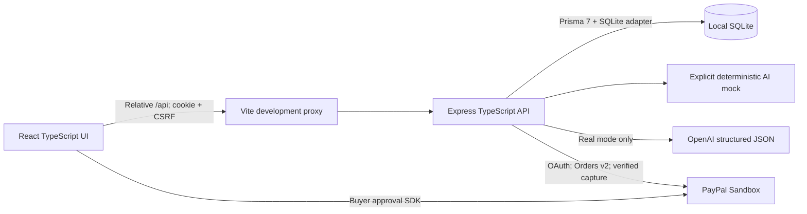
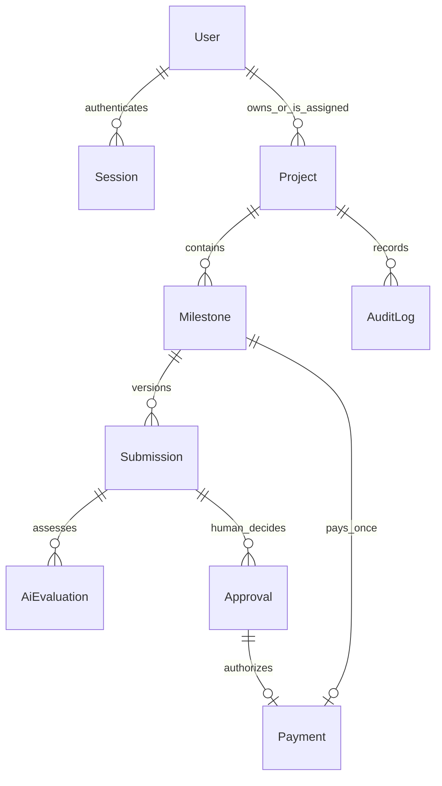
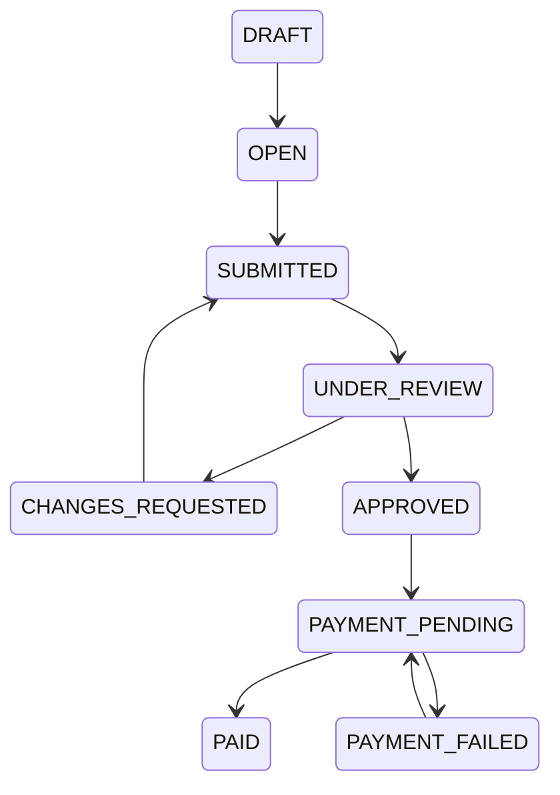

# VeriFlow AI

**Verify Work. Build Trust. Pay Smarter.**

VeriFlow AI helps clients and freelancers agree on measurable milestones, preserve submission evidence, obtain advisory AI assessments, and authorize PayPal Sandbox checkout after human approval. It is built for the PayPal AI Hackathon 2026 in the existing TypeScript workspace.

## Status and honest boundaries

The local application includes persistent projects, registration/login/logout, role and ownership authorization, milestone agreements, revisions, human decisions, audit records, dashboards, editable AI proposals and evidence reports. AI defaults to an explicitly labeled deterministic simulation. A real OpenAI structured-output adapter and real PayPal Sandbox Orders v2 adapter are implemented.

**Live OpenAI requests and buyer-approved Sandbox captures have not been verified: credentials are not configured.** Automated payment tests use controlled responses, and one browser test intercepts checkout responses. Those are not evidence of a real Sandbox transaction. See [test results](docs/TEST_RESULTS.md), [progress](docs/PROGRESS.md), and [final report](docs/FINAL_REPORT.md).

This application is not escrow, does not hold funds on behalf of users, and does not send freelancer payouts. Sandbox checkout uses test money sent to the configured Sandbox merchant. AI cannot approve work or authorize payment. Production deployment requires additional operational review; this is a local hackathon application.

## Problem, impact and solution

Freelance disputes often start with unclear completion criteria and missing delivery evidence. A binary done/not-done decision hides uncertainty and makes payment review difficult. Clients, independent contractors, small agencies and businesses need a shared record of what was agreed, what was submitted and who decided.

VeriFlow links each agreement to integer-valued payment amounts, versioned submissions, criterion-level advisory reports, explicit human decisions and server-verified transaction records. It makes uncertainty visible instead of treating an AI opinion or a checkout callback as proof.

## Quick start on Windows

Install **Node.js 24 LTS** and npm; Git is needed for collaboration. Verified environment: Node v24.19.0, npm 11.17.0. No Docker or paid infrastructure is required for mock-mode local development. Native SQLite/bcrypt dependencies usually use downloaded prebuilt binaries; a platform without a compatible prebuild may require C++ build tools.

If you already have this folder, use it. For a new checkout only:

```powershell
git clone https://github.com/padalasuraj/veriflow.git
cd veriflow
```

The configured remote was verified as public via an unauthenticated GitHub API read. This local implementation has not been committed or uploaded.

From `F:\Projects\VeriFlow` (Terminal 1):

```powershell
npm.cmd install
# Only copy if backend/.env does not already exist. Preserve existing credentials.
if (-not (Test-Path backend/.env)) { Copy-Item backend/.env.example backend/.env }
npm.cmd run db:generate
npm.cmd run db:migrate
npm.cmd run db:seed
npm.cmd run db:verify
npm.cmd run dev
```

Open **http://localhost:5173**. API health: **http://localhost:3001/api/health**. Keep Terminal 1 running; Ctrl+C stops both services. In PowerShell use `npm.cmd` when execution policy blocks `npm.ps1`. On other shells use `npm`.

Alternatively use two terminals, each at the root:

```powershell
# Terminal 1: API
npm.cmd run dev -w backend
# Terminal 2: web (run this in the other terminal)
npm.cmd run dev -w frontend
```

Vite requires port 5173 and proxies relative `/api` requests to port 3001. Do not open the frontend at another origin without updating backend `FRONTEND_ORIGIN`. After installing dependencies from an existing lockfile, `npm.cmd ci` is the reproducible alternative to `install`. Approved dependency lifecycle scripts are listed with versions in root `package.json`.

## Demo accounts and data

Run `npm.cmd run db:seed` locally. The non-destructive seed preserves existing accounts and project progress; it does not reset an existing demo. Seeding is disabled with `NODE_ENV=production`.

| Role | Email | Local demo password |
| --- | --- | --- |
| Client | `client@veriflow.local` | `VeriflowDemo2026!` |
| Freelancer | `freelancer@veriflow.local` | `VeriflowDemo2026!` |

These are public local-only demo credentials, not PayPal buyer credentials. Never seed them into a publicly accessible deployment. The seeded **Studio website launch** project has UI Design $150, Frontend Implementation $250 and Final Delivery $200, totaling $600 USD. To repeat a clean demo, register new local users and create another project; do not delete existing history.

## Feature map and user journey

1. Register as CLIENT or FREELANCER; sign in with an opaque, expiring HttpOnly session cookie.
2. Client creates a project with requirements, deliverables, integer minor-unit budget and currency. Assign a registered freelancer by email at creation or later.
3. Before allocating budget, request an AI milestone draft. Review its mode label, risks and dependencies. Edit each suggestion and explicitly save it, or create milestones manually.
4. Client can edit a draft/open milestone until its first submission. Allocation cannot exceed the project budget. Currency locks once milestones exist; reassignment locks after any submission.
5. Assigned freelancer submits a description, reproduction notes and optional repository/demo references. Links are stored but not fetched. A changes request permits a new numbered revision; earlier evidence is preserved.
6. Client starts review. Either project participant may request an advisory AI report for a submission. Reports disclose unverified claims, missing evidence and limitations; AI never changes decision/payment state.
7. Client independently inspects the current evidence, records notes and approves or requests changes. Stale/repeated decisions and unauthorized operations are rejected on the server.
8. After approval, the client loads PayPal Sandbox checkout, signs in with a separate Sandbox buyer, and approves the stored amount. Backend captures and checks the order, milestone, invoice, capture status, amount and currency.
9. Only a verified completed capture becomes PAID. Both participants see persistent payment history, receipts and project audit events. Unknown/time-out outcomes remain unresolved until reconciliation.

Settings displays account identity and nonsecret integration configuration. Dashboard counters and progress bars come from authorized API data; there are no fake revenue or adoption metrics.

## Architecture and technology choices



| Technology | Why it is used |
| --- | --- |
| React + TypeScript + Vite | Typed interactive pages and fast local development |
| Tailwind CSS + app CSS, Lucide | Consistent responsive styling and navigation icons |
| React Router | Public authentication and protected workspace routes |
| TanStack Query | Server-data caching and invalidation after actions |
| React Hook Form + Zod | Form state and validated typed inputs |
| Express + TypeScript | Small testable API and explicit business rules |
| Prisma 7.10.1 + SQLite | Relational local persistence, migrations, transactions and uniqueness |
| bcrypt + opaque cookie sessions | Password hashing and revocable server-side sessions |
| Helmet, CORS, rate limits | Baseline browser headers, origin controls and abuse limits |
| OpenAI structured outputs + Zod | Schema-constrained real requests with runtime output validation |
| PayPal Orders v2 + JavaScript SDK | Server-controlled Sandbox pricing/capture and buyer approval |
| Vitest, Supertest, Testing Library, Playwright | Unit, API, component and browser verification |
| GitHub Actions | Reproducible install, database setup, checks, tests and builds |

Recharts is not added: actual paid-milestone progress is clear with accessible counts and progress bars. No chart displays invented data.

## Repository map and important files

```text
VeriFlow/
  README.md, LICENSE, .gitignore, .env.example
  package.json, package-lock.json, eslint.config.mjs, playwright.config.ts, tsconfig.tools.json
  .github/workflows/ci.yml
  backend/
    package.json, tsconfig.json, tsconfig.build.json, prisma.config.ts, .env.example
    scripts/{migrate,verify-demo,smoke-built}.ts
    prisma/
      schema.prisma, seed.ts
      migrations/20261017161842_init/migration.sql
      migrations/migration_lock.toml
    src/
      app.ts, server.ts, app.test.ts
      config/{database,env}.ts
      middleware/auth.ts
      routes/{auth,projects,milestones,ai,payments}.routes.ts
      services/{access,lifecycle}.ts
      utils/{errors,money}.ts
      ai/{provider.interface,mock.provider,real.provider,schemas}.ts
      paypal/{client,verification}.ts
      tests/{domain,workflow}.test.ts
  frontend/
    package.json, index.html, tsconfig.json, vite.config.ts, .env.example
    public/favicon.svg
    src/
      main.tsx, App.tsx, index.css
      services/api.ts, types/domain.ts, contexts/AuthContext.tsx
      components/
        layout/WorkspaceLayout.tsx, ui/Common.tsx
        milestones/MilestoneEditor.tsx, evidence/EvidenceForm.tsx
        ai/EvaluationReport.tsx, payments/PayPalCheckout.tsx
      pages/
        LandingPage.tsx, AuthPage.tsx, Dashboard.tsx, CreateProject.tsx
        ProjectDetail.tsx, MilestoneDetail.tsx, AccountPages.tsx
      tests/{setup.ts,App.test.tsx}
  e2e/{health,workflow,checkout}.spec.ts
  docs/
    IMPLEMENTATION_PLAN.md, PROGRESS.md, TEST_RESULTS.md, FINAL_REPORT.md
    ARCHITECTURE.md, DATABASE.md, API.md, AI_ENGINE.md, PAYPAL.md
    SECURITY.md, TESTING.md, DEPLOYMENT.md, DEMO.md, DEVPOST.md
```

Frontend `App.tsx` defines routes, `Protected` loads identity/CSRF state, and `WorkspaceLayout` supplies role-neutral navigation. Pages assemble focused forms/reports; `services/api.ts` owns HTTP behavior. Business state and permissions are enforced by the backend, never inferred from UI controls.

Backend request lifecycle: security headers/rate limit -> bounded JSON parser -> health route or cookie/session lookup -> origin/CSRF validation -> route authentication -> Zod input validation -> ownership and lifecycle checks -> transactional persistence/audit -> JSON result. `app.ts` assembles the testable app; `server.ts` validates configuration, listens and handles shutdown. `access.ts` centralizes private resource checks. `payments.routes.ts` owns persistent payment coordination, while `paypal/client.ts` owns external transport and `verification.ts` independently checks captures.

## Database and lifecycle

Prisma models: User, Session, Project, Milestone, Submission, AiEvaluation, Approval, Payment and AuditLog. Email, token hash, project sequence, submission revision, milestone payment, approval payment, PayPal order/capture IDs and request IDs have unique constraints. Foreign keys preserve relationships. Project ownership, assignment, session expiry, report history, payment status and audit timeline have indexes. Money uses integer minor units; supported currencies USD/EUR/GBP/CAD/AUD all have two decimals.





New milestones default OPEN; choose DRAFT in the editor to prepare before opening. Human review has an explicit Start review action and does not depend on AI availability. Agreement edits are blocked after evidence exists. No deletion endpoint removes evidence, approvals or payment history. More details: [database](docs/DATABASE.md), [API](docs/API.md).

## Authentication, authorization and payment security

Passwords use bcrypt cost 12 with a 72 UTF-8 byte limit. Sessions use random 256-bit tokens; only SHA-256 token hashes are stored. Cookies expire after seven days, are HttpOnly/SameSite=Lax, and use Secure plus the `__Host-` prefix in production. Logout deletes the session. Authenticated writes require a per-session CSRF header; origin and Fetch Metadata checks reject cross-site writes. Browser route protection is supplemented by server role/ownership checks on every private resource.

Only project clients create/edit agreements, start review, decide and pay. Only the assigned freelancer submits. Both participants may inspect evidence, reports, audit and receipts. Unauthorized resource IDs return 404 to avoid revealing private records. Login and AI requests have additional rate limits. Production needs TLS, backups, account recovery, monitoring and deployment-specific hardening; see [security](docs/SECURITY.md).

Payment amounts always come from the database. Request IDs survive retries. One payment row per milestone and unique capture IDs protect persistence. A database lease prevents concurrent capture; capture retries retrieve the order first to reconcile uncertain outcomes. The same idempotency key is reused; expired creation/capture attempts require manual reconciliation rather than issuing a second order. The app never marks PAID from a browser callback alone. See [PayPal](docs/PAYPAL.md) for exact setup and limitations.

## Environment configuration

Copy `backend/.env.example` to `backend/.env` only if it does not already exist. Root `.env.example` is an inventory and is not automatically loaded. No private credential belongs in a `VITE_*` variable, browser storage, source control, screenshots or chat. Root `.gitignore` protects `.env` variants, database files, logs and generated reports; example templates remain trackable.

| Variable | Default / purpose |
| --- | --- |
| `PORT` | `3001`, integer TCP port |
| `FRONTEND_ORIGIN` | `http://localhost:5173`, exact origin without trailing slash |
| `NODE_ENV` | `development`, `test` or `production`; controls Secure cookie and seed restriction |
| `DATABASE_URL` | `file:./prisma/dev.db`, relative to backend working directory for scripts |
| `AI_MODE` | `mock` or `real`; explicit, never silent fallback |
| `AI_MODEL` | `gpt-4.1-mini`; choose a model supporting Chat Completions strict JSON schema |
| `AI_API_KEY` | Private OpenAI key; required only in real mode |
| `PAYPAL_ENV` | Only `sandbox` is accepted; live mode is rejected |
| `PAYPAL_CLIENT_ID` | Sandbox REST app client ID; public ID is exposed only through authenticated config |
| `PAYPAL_CLIENT_SECRET` | Private Sandbox REST app secret; backend only |

Restart the API after configuration changes. If changing `PORT`, update the proxy in `frontend/vite.config.ts` too.

## Real AI setup, workflow and limitations

1. Create an OpenAI API key in your own account and confirm model access/billing.
2. Set `AI_MODE=real`, `AI_API_KEY` and optionally `AI_MODEL` in backend/.env.
3. Restart the API. Request a draft from an unallocated project or evaluate a submission.
4. Record provider/model, date, actual result and limitations in `docs/TEST_RESULTS.md` without credentials.

The adapter posts to OpenAI Chat Completions with strict JSON schema derived from Zod, a 3500 completion-token cap and 30-second timeout. Both inputs and outputs are bounded/validated; planner allocations must total the requested budget, and evaluator criteria must match the agreement. Real-mode failure returns an error and never switches to mock. Both modes show provenance. The mock is a deterministic simulation; its evaluator conservatively asks for independent evidence.

No browsing tools are provided to either mode. Repository/demo URLs are unverified strings, and the server appends a mandatory no-inspection limitation. Submitted claims and notes may be sent to OpenAI in real mode; avoid confidential or unnecessary personal information. Prompt injection and model errors remain possible, so all recommendations require human judgment. [AI engine](docs/AI_ENGINE.md) explains the contract.

## PayPal Sandbox setup and actual payment test

1. Sign in at the PayPal Developer Dashboard and use **Testing Tools -> Sandbox Accounts**. Create a Business merchant and a separate Personal buyer.
2. Under **Apps & Credentials**, select Sandbox and create a REST app associated with the Business account.
3. Copy its Sandbox client ID and secret privately into backend/.env; keep `PAYPAL_ENV=sandbox`.
4. Restart the backend. Client approves the current milestone and selects Load PayPal Sandbox checkout.
5. Use the Personal Sandbox buyer credentials in PayPal's approval window. Never use real buyer credentials or claim a live payout.
6. After approval, the backend retrieves/captures and verifies the order. Confirm the stored capture ID, exact currency and amount against the merchant's Sandbox dashboard.
7. Refresh and reconcile the stored order; verify exactly one payment and a SANDBOX_PAYMENT_CONFIRMED audit event. Exercise cancellation and failures separately.

The browser uses the official PayPal JavaScript SDK for buyer approval; private OAuth and Orders v2 calls use only `api-m.sandbox.paypal.com`. Missing configuration visibly disables checkout. Timeout failures are not proof of failure to charge: reconcile the existing order, never create an unrelated replacement. [PayPal guide](docs/PAYPAL.md) covers the acceptance record and recovery.

## Tests, checks and production build

In another terminal at the root while developing:

```powershell
npm.cmd run db:generate
npm.cmd run lint
npm.cmd run typecheck
npm.cmd test
npm.cmd run build
npm.cmd exec playwright install chromium
npm.cmd run test:e2e
```

API tests migrate an isolated temporary SQLite file and inject controlled external transports. The live browser workflow creates unique local accounts/projects and preserves them. Checkout UI tests explicitly intercept provider responses. Playwright starts development services if needed; when reusing servers, ensure they belong to this checkout and use mock AI/unconfigured PayPal for the offline suite. See [testing](docs/TESTING.md) and the actual [results](docs/TEST_RESULTS.md). CI has been configured, but its remote execution is not verified.

`build` outputs `frontend/dist` and `backend/dist`. `npm.cmd start` starts the compiled API only, with backend as working directory. A production frontend must be served separately with an SPA fallback and a same-origin `/api` reverse proxy. Use TLS and `NODE_ENV=production`; do not expect Secure cookies to work on plain HTTP. [Deployment guide](docs/DEPLOYMENT.md).

## Troubleshooting and known limitations

| Symptom | Resolution |
| --- | --- |
| PowerShell blocks npm.ps1 | Use npm.cmd |
| API cannot start / frontend offline | Check port 3001, API logs and backend/.env; restart both processes |
| Vite port busy | Stop the specific old dev server; strict port prevents origin drift |
| Missing tables / generated client | Run db:generate then db:migrate from root |
| Fresh Windows SQLite migration error | Use the supplied db:migrate wrapper, which creates the parent directory and empty file safely |
| CSRF/session error | Refresh to load current session; sign in again if expired; use localhost consistently |
| Freelancer not found | Register the freelancer before assigning their exact email |
| Budget exceeded | Reduce allocation or increase project budget; money inputs are minor units |
| Cannot edit an agreement | It is locked after its first submission; use changes requests and revisions |
| AI real-mode error | Check key/model/access/network; no mock fallback is performed |
| PayPal unavailable | Configure Sandbox app credentials, separate buyer, popup/network access; reconcile uncertain orders |
| Deep link fails after deployment | Configure frontend SPA fallback and API reverse proxy |

Current limits include local SQLite/single-instance deployment assumptions, 100-record list windows (audit supports offset), no password reset/email verification/invitations, no evidence file upload or external link inspection, no webhooks/refunds/payouts, and manual operator recovery after the safe PayPal retry window. No real AI response or real Sandbox capture has been accepted yet. Shared production hosting, multi-process stress testing and provider account actions remain human gates. Future improvements should address these before adding unrelated features.

## Collaboration, demo and submission

Use `main`, `develop` and feature branches `feature/frontend`, `feature/backend`, `feature/ai`, `feature/paypal`; review pull requests and require CI. Suggested owners: developer 1 backend/database/auth; developer 2 frontend/accessibility; developer 3 AI; developer 4 PayPal, tests and demo. No automatic commit, push, hosting publication or submission is performed.

The supplied submission target is **before November 13, 2026 at 1:30 AM IST**; the team must confirm the organizer's actual rules and deadline. Prepare an under-three-minute public YouTube demo showing only actual implemented behavior, a reviewed public source repository and a Devpost story. [Demo script](docs/DEMO.md), [Devpost draft](docs/DEVPOST.md) and [final report](docs/FINAL_REPORT.md) identify remaining human actions. Never present a mocked checkout as a real Sandbox capture or publish credentials.

## License and references

MIT; see [LICENSE](LICENSE). Review license attribution when preparing a public release.

Primary integration references used: [Prisma SQLite](https://www.prisma.io/docs/prisma-orm/quickstart/sqlite), [OpenAI structured outputs](https://developers.openai.com/api/docs/guides/structured-outputs?api-mode=chat), [PayPal checkout integration](https://developer.paypal.com/docs/checkout/standard/integrate/). These document the upstream APIs; local and external verification are recorded separately in this repository.
