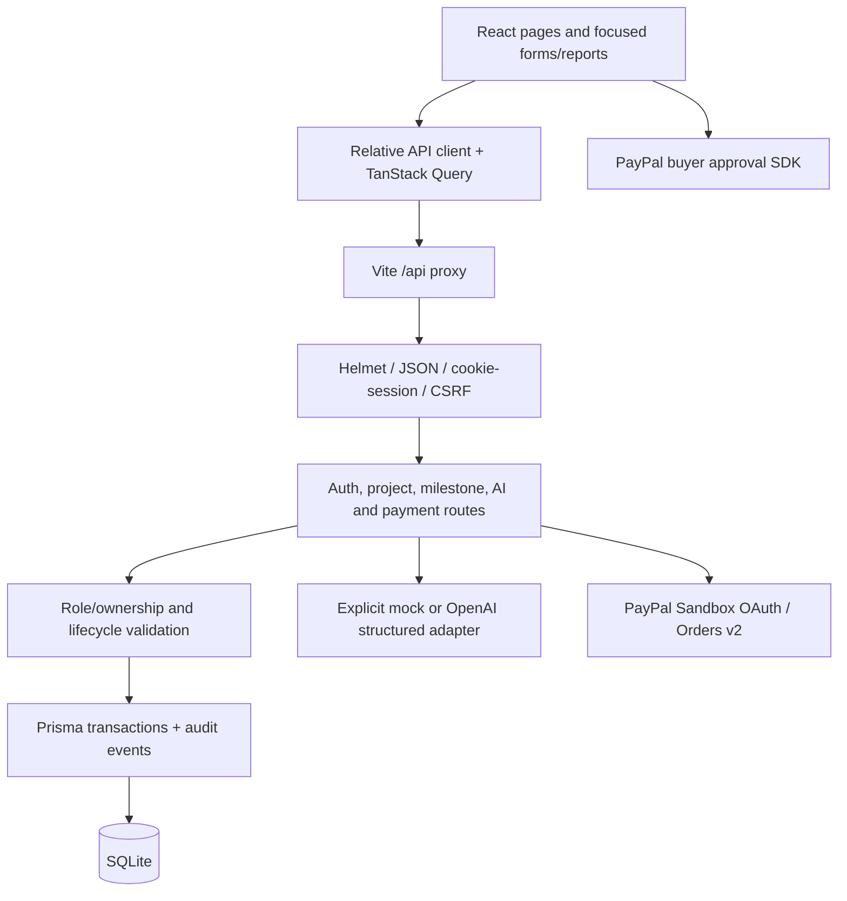

# Architecture

VeriFlow extends the existing npm workspaces rather than adding another repository. React/TypeScript runs through Vite; Express/TypeScript owns authorization, workflow rules and external integration. Prisma 7.10.1 and its better-sqlite3 adapter persist the local relational model.

## Boundaries and file ownership

- frontend/src/pages assembles the user journey. App.tsx defines public and protected routes; AuthContext loads session/CSRF and invalidates local state on logout. WorkspaceLayout provides navigation.
- Components separate milestone editing, evidence submission, AI reports and checkout. services/api.ts owns HTTP JSON, timeout and CSRF headers; types/domain.ts contains browser-safe contracts. React never receives a secret or decides ownership/payment validity.
- backend/src/app.ts creates an injectable app for tests; server.ts validates env and manages listening/shutdown. config/database.ts creates the runtime/test Prisma clients.
- middleware/auth.ts manages session identity, cookies, role guards and CSRF. services/access.ts checks resource ownership and builds audit entries; lifecycle.ts documents legal transitions.
- Route modules perform Zod parsing, access checks and transactional workflow mutations. Business validation lives on the backend even when a UI control is hidden or disabled.
- ai providers expose structured plan/evaluate operations. Mock mode is explicit and deterministic; real mode does not fall back. No provider fetches evidence links.
- paypal/client.ts is fixed to Sandbox transport; verification.ts checks financial identity/status/amounts. payments.routes.ts coordinates persistent attempts, idempotency and capture leases.
- Prisma schema/migrations are authoritative for relational persistence. Tests migrate isolated temporary databases. No in-memory store substitutes for runtime financial or workflow records.

## Key decisions

Integer minor units and a two-decimal currency allowlist prevent floating-point payment arithmetic. Submitted agreements lock before review; revisions preserve the historical evidence. Human decisions are distinct from AI reports and from payment capture. A single durable payment per milestone avoids replacing uncertain transactions; retry retrieves the existing order and uses the same request IDs.

SQLite and local sessions keep hackathon setup simple. Production multi-instance deployment, backups and external account acceptance are separate gates. The frontend production bundle needs its own static host/SPA fallback and same-origin API proxy; the Express start script serves the API only.

No publishing, provider account provisioning, YouTube upload or Devpost submission is automatic. The implementation plan and final report distinguish built features, executed tests and external acceptance.
